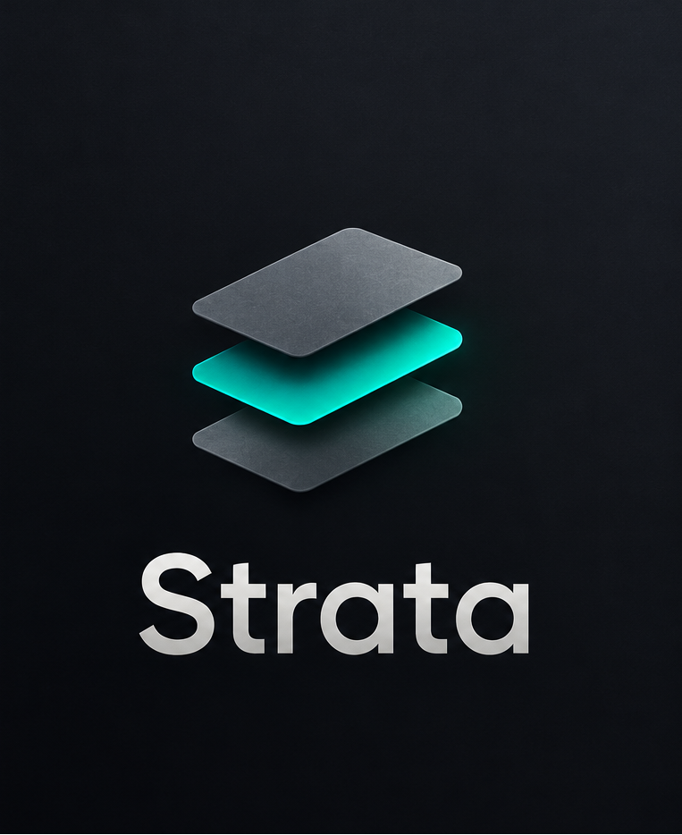
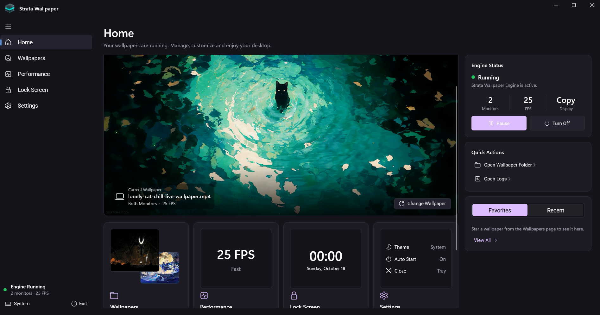

<div align="center">
  
  <h1>Strata Wallpaper</h1>
  <p><b>A lightweight, high-performance Windows 11 live wallpaper engine.</b></p>
  
  [](https://www.microsoft.com/windows/windows-11)
  [](https://isocpp.org/)
  [](https://learn.microsoft.com/en-us/dotnet/csharp/)
  [](https://learn.microsoft.com/en-us/windows/apps/winui/winui3/)
</div>

<br />

Strata seamlessly plays your favorite videos behind your desktop icons while maintaining a beautiful, modern interface to manage them. Built with a C++ `libmpv` backend for low GPU usage, and a WinUI 3 control panel for a premium feel.

## 📸 Screenshots


*(The Strata Control Panel featuring the Catppuccin theme)*

---

## ✨ Features

- **Live Desktop:** Plays videos directly behind your desktop icons using WorkerW embedding.
- **Multi-Monitor Support:** Copy, Stretch, and Individual display modes across all your screens.
- **Smart Pause:** Automatically freezes playback when a fullscreen game is open, when you're on battery saver, during RDP sessions, or when locked.
- **Lock Screen Overlay:** A customizable screensaver-style overlay with password protection and a live clock.
- **Day/Night System:** Automatically swaps wallpapers based on Sunrise/Sunset or Islamic Prayer Times.
- **5 Beautiful Themes:** Ships with Aura, Catppuccin, Dracula, Tokyo Night, and Rosé Pine. Each theme includes Light/Dark modes, 9 custom accent colors, and dynamic developer fonts (Cascadia Code, JetBrains Mono, Fira Code).
- **Performance Focused:** Adjust FPS limits, quality presets (including RTX VSR), and GPU scalers to save resources.

---

## 📥 Installation (For Users)

1. Go to the [**Releases**](https://github.com/Nobodyssssy/Strata-Wallpaper/releases) page.
2. Download the latest **`StrataWallpaper_Setup.exe`**.
3. Run the installer and follow the prompts.
4. Launch **Strata Wallpaper** from your Start Menu or Desktop shortcut.

> **Note:** Windows 11 is required. All dependencies (including the `libmpv-2.dll` video backend) are bundled inside the installer.

---

## 🛠️ Building from Source (For Developers)

### Prerequisites
- **Visual Studio 2022** (with C++ Desktop Development and .NET Desktop Development workloads).
- **Windows 11 SDK** (10.0.19041.0 or newer).
- **`libmpv-2.dll`** (This file is 154MB and is excluded from the repository due to GitHub limits. You must download it from the [mpv project](https://sourceforge.net/projects/mpv-player-windows/files/libmpv/) and place it in `libs\mpv\`).

### Steps
1. Clone the repository:
   ```bash
   git clone https://github.com/Nobodyssssy/Strata-Wallpaper.git


Contributing

Contributions, issues, and feature requests are welcome!
Feel free to check the issues page.
How to Contribute

    Fork the project.

    Create your feature branch (git checkout -b feature/AmazingFeature).

    Commit your changes (git commit -m 'Add some AmazingFeature').

    Push to the branch (git push origin feature/AmazingFeature).

    Open a Pull Request.

Code Style & Architecture Rules

    C++ Engine: Follow standard C++11/14 conventions. Ensure no memory leaks or detached threads outlive the application lifecycle. All IPC requests are handled on the main thread.

    C# Panel: Follow standard .NET conventions.

        Use async/await for all I/O.

        Crucial: Wrap all async void event handlers in the SafeRun() method to prevent app crashes.

        Crucial: When adding new UI controls (Sliders, Toggles), wire their events in the constructor after InitializeComponent(), and use a _loading boolean flag to prevent them from firing during initial XAML parse.

    Theming: Do not hardcode colors (e.g., #FFFFFF, Colors.Black). Always use {ThemeResource ...} in XAML, and pull brushes via Application.Current.Resources["..."] in C#. If a new color is needed, add it to all 5 theme dictionaries.

📄 License

Distributed under the MIT License. See LICENSE for more information.
🙏 Acknowledgments

    Video playback powered by libmpv.

    UI built with WinUI 3.

    Themes inspired by Dracula, Catppuccin, Tokyo Night, and Rosé Pine.
